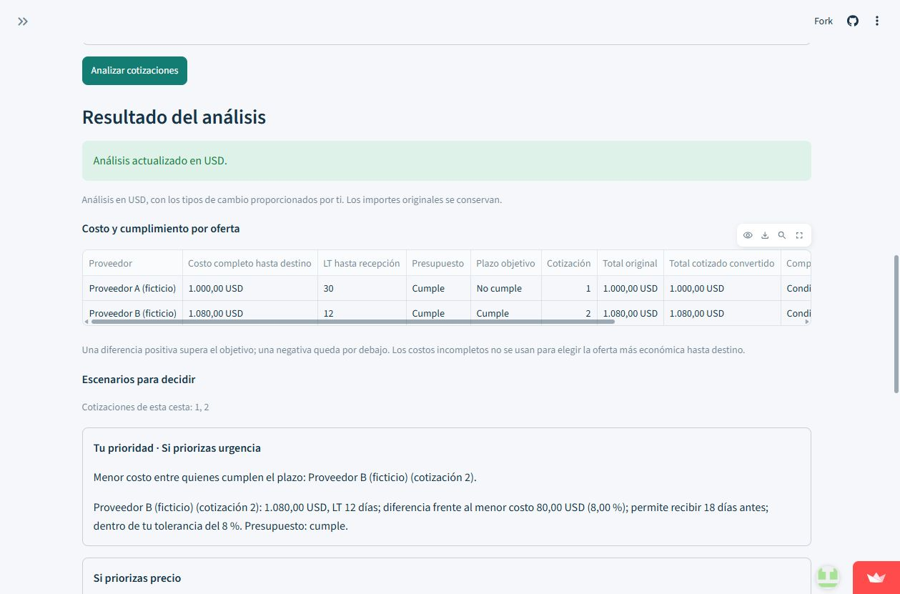
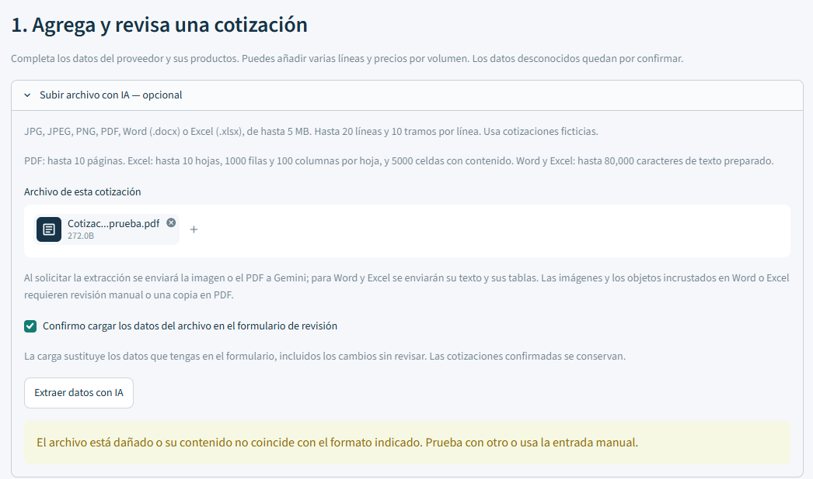
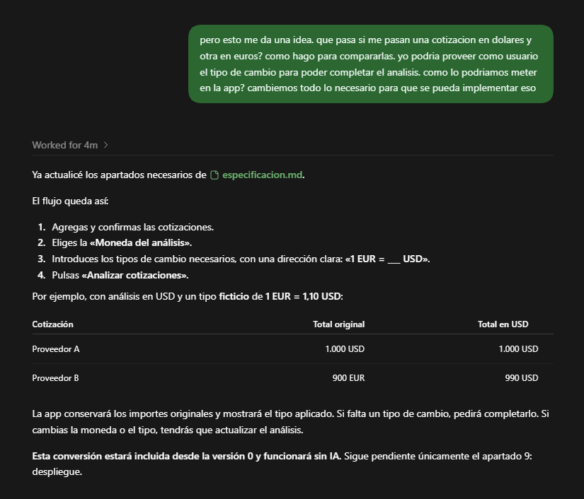
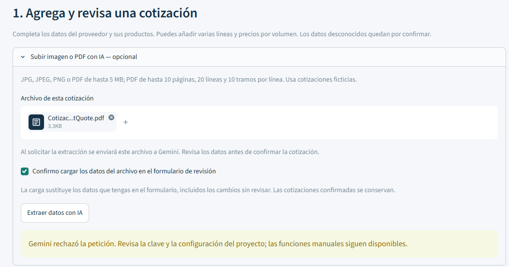

# SmartQuote

**Enlace a la app:** [Abrir SmartQuote](https://smartquote.streamlit.app/)

**Autor/a:** [kcs191095](https://github.com/kcs191095)

**Repositorio:** [kcs191095/SmartQuote](https://github.com/kcs191095/SmartQuote)

Prototipo académico del Máster en Inteligencia Artificial de OBS Business School. Ayuda a compradores de pequeñas y medianas empresas a registrar, revisar y comparar cotizaciones.

**¿Es tu primera vez?** Empieza con [el ejemplo ficticio](#probarla-con-un-ejemplo) para conocer el análisis antes de introducir tus cotizaciones ficticias. Los objetivos de compra, el precio actual y el forecast son opcionales; puedes dejarlos vacíos para comenzar con una comparación básica.

## Pitch

Los compradores de pequeñas y medianas empresas dedican tiempo a ordenar cotizaciones con precios, monedas y condiciones diferentes para decidir qué oferta les conviene.
SmartQuote reúne esas ofertas y compara costos y plazos: en el ejemplo ficticio que probé, pagar 80 USD más permite recibir el pedido 18 días antes.
La IA lee los documentos y explica los resultados calculados por Python, mientras el comprador revisa los datos y toma la decisión.
Al probarla aprendí que una conexión correcta con la IA no garantiza que la lectura funcione, por lo que ajustamos la solicitud de extracción del PDF y comprobé el resultado.
Mi siguiente mejora sería mostrar primero los campos básicos y agrupar los opcionales, porque pude usar la app sin ayuda, pero tantos campos pueden abrumar a quien empieza.

## El problema

Un comprador de una pequeña o mediana empresa recibe cotizaciones de distintos proveedores en PDF, imágenes, Word o Excel.
Normalmente revisa los documentos y copia los datos a una hoja de cálculo para comparar precios, cantidades, plazos y condiciones.
Las diferencias de moneda, los gastos pendientes y las condiciones de compra pueden hacer que el menor precio unitario no sea la opción más conveniente.
SmartQuote organiza esa información y muestra escenarios con sus condiciones, para que el comprador pueda tomar una decisión con datos comparables.

## Qué hace la app

1. **Agrega una cotización.** Pulsa «Agregar cotización» y completa los campos manualmente o abre «Subir archivo con IA — opcional». Para extraer un archivo, confirma la carga y pulsa «Extraer datos con IA». Puedes combinar ambos métodos entre proveedores.
2. **Revisa las líneas y condiciones.** Comprueba proveedor, producto, cantidad, unidad de medida, precio, moneda, cantidad mínima de compra (MOQ), múltiplos y precios por volumen. Revisa también entrega, pago, Incoterm y gastos. Completa los datos que queden «Por confirmar».
3. **Confirma cada oferta.** Pulsa «Revisar cotización» y comprueba la tabla preliminar. Solo «Confirmar y agregar» incorpora la oferta a las cotizaciones confirmadas. Extraer un archivo no confirma una compra ni una cotización.
4. **Prepara la comparación.** Con al menos dos cotizaciones confirmadas, elige la moneda del análisis e introduce los tipos de cambio necesarios. Confirma qué productos y unidades son equivalentes y qué gastos y plazos cubren el mismo destino.
5. **Añade tus objetivos si los necesitas.** Precio objetivo, presupuesto, plazo de entrega y tolerancia al sobrecosto son opcionales. También puedes indicar precio actual, volumen previsto o forecast, su periodo y un plan de pedidos para evaluar ahorro potencial.
6. **Analiza y revisa los escenarios.** Pulsa «Analizar cotizaciones». La app conserva los importes originales y muestra conversiones, costos disponibles, cumplimiento de objetivos y escenarios de precio y urgencia. Cuando hay información suficiente, añade savings y alternativas de volumen.
7. **Solicita una explicación con IA.** Pulsa «Explicar análisis con IA» para obtener una interpretación de los resultados y de lo que falta confirmar. Si cambias los datos, actualiza el análisis y solicita otra explicación.

### Probarla con un ejemplo

En una sesión vacía, pulsa «Cargar ejemplo ficticio» y después «Analizar cotizaciones».

| Oferta del ejemplo | Costo completo | Plazo de recepción |
|---|---|---|
| Proveedor A | 1.000 USD | 30 días |
| Proveedor B | 1.080 USD | 12 días |

Con presupuesto de 1.100 USD y plazo objetivo de 15 días, A tiene el menor costo y B cumple ambos objetivos: cuesta 80 USD más, un 8 %, y entrega 18 días antes. El ejemplo incluye una tolerancia al sobrecosto del 8 %; esa condición se muestra junto con el resto de los objetivos.

También hay documentos inventados en la [carpeta de ejemplos](https://github.com/kcs191095/SmartQuote/tree/main/ejemplos).

### Condiciones y límites

- Usa únicamente cotizaciones ficticias, sin datos personales reales ni información comercial confidencial.
- Se admiten JPG/JPEG, PNG, PDF, Word `.docx` y Excel `.xlsx`, de hasta 5 MB. Los PDF pueden tener hasta 10 páginas; la extracción admite hasta 20 líneas y 10 tramos de precio por línea.
- Word y Excel se preparan como texto y tablas. Las imágenes y los objetos incrustados requieren revisión o una copia en PDF. Las fórmulas de Excel no se ejecutan; un importe que dependa de ellas necesita confirmación.
- Excel admite hasta 10 hojas, 1.000 filas y 100 columnas por hoja, y 5.000 celdas con contenido. El texto preparado de Word o Excel tiene un límite de 80.000 caracteres.
- Los tipos de cambio los aporta el usuario. Una conversión de moneda no demuestra que dos productos o unidades sean equivalentes.
- Un MOQ es una cantidad mínima, no un múltiplo obligatorio. Si no está indicado, usar 1 requiere aceptar expresamente ese supuesto.
- El forecast no equivale a un único pedido. Un precio por volumen solo se utiliza cuando se cumplen sus cantidades y condiciones.
- Los savings son diferencias o proyecciones de precio sujetas a las condiciones indicadas; no demuestran por sí solos un ahorro neto realizado.
- Un dato ausente no se convierte en cero. Los gastos o plazos incompletos limitan los escenarios que pueden calcularse.
- La app registra el Incoterm, la versión y el lugar convenido; no deduce de ellos importes de transporte o impuestos.
- Las cotizaciones se mantienen en la sesión de uso. La app no ofrece un historial permanente de compras.
- La selección del proveedor, la negociación y la decisión de compra corresponden al comprador.

## La pieza de IA

- **Qué usa:** API de Gemini, con el SDK `google-genai` y el modelo configurado en `MODELO` de `app.py`: `gemini-3.5-flash-lite`.
- **Por qué esa opción:** permite interpretar imágenes y PDF y organizar el texto de Word y Excel sin entrenar un modelo propio. La misma API ayuda a explicar los escenarios que ya calculó el programa.
- **Qué se envía:** al solicitar la extracción, se envía a Gemini la imagen o el PDF; para Word y Excel, se envían el texto y las tablas preparados. Para explicar el análisis, se envían los hechos calculados y la configuración utilizada.
- **Qué hace Python:** valida entradas, calcula importes y conversiones con precisión decimal, comprueba condiciones de compra y determina los resultados de cada escenario. La IA no sustituye esos cálculos.
- **Qué pasa si falla:** las llamadas están protegidas con `try/except`. Si falta la clave, se agota la cuota, falla la conexión, el modelo no está disponible o la respuesta no es válida, aparece un mensaje claro. Las cotizaciones confirmadas y las funciones manuales permanecen disponibles.
- **Dónde está la clave:** en los secretos de Streamlit, con el nombre `GEMINI_API_KEY`, leída mediante `st.secrets`. La clave no se incluye en el código ni en este documento.

El proyecto sigue el requisito de coste cero del curso. El uso de IA depende de la cuota y de la disponibilidad del servicio; las peticiones se realizan solo al pulsar los botones correspondientes. La revisión humana de los datos extraídos y de las explicaciones sigue siendo necesaria.

## Cómo la he construido

- **Herramientas:** Codex como asistente de desarrollo; Python y Streamlit para la app; GitHub para el repositorio; Streamlit Community Cloud para el despliegue; API de Gemini para la extracción y la explicación.
- **Fichero de contexto del agente:** [AGENTS.md](https://github.com/kcs191095/SmartQuote/blob/main/AGENTS.md).
- **Especificación:** [especificacion.md](https://github.com/kcs191095/SmartQuote/blob/main/especificacion.md).

Partí del problema de comparar cotizaciones y fui concretando las reglas de compra mediante la conversación con el agente. La especificación recoge el comportamiento esperado y los casos de aceptación. En `AGENTS.md` dejé el contexto del proyecto, cómo ejecutarlo y las reglas que debía respetar el agente, como proteger la clave, mantener la revisión del usuario y trabajar con datos ficticios.

### Prompts clave

Estos tres mensajes son parte de la conversación real de desarrollo y se conservan tal como los escribí. Después de cada uno explico qué ayudó a definir.

**1. Revisión y confirmación de los datos extraídos**

> si la idea es que se pase la imagen y si hay algo ilegible le indique al usuario que ponga los restantes en los espacios. al final que de una tabla con toda la info de esa cotizacion y que pida confirmar si es correcta. y las va acumulando en una tabla de cotizaciones y cuando ya se agregaron todas comience con el analisis

**Para qué me sirvió:** Con este mensaje definí que la información leída de un documento debía presentarse para revisión y que los campos ilegibles se pudieran completar manualmente. Así quedó separado el borrador de la cotización confirmada. Al concretar el flujo, añadimos el botón «Analizar cotizaciones» para que el usuario decida cuándo iniciar la comparación.

**2. Comparación entre monedas**

> pero esto me da una idea. que pasa si me pasan una cotizacion en dolares y otra en euros? como hago para compararlas. yo podria proveer como usuario el tipo de cambio para poder completar el analisis. como lo podriamos meter en la app? cambiemos todo lo necesario para que se pueda implementar eso

**Para qué me sirvió:** Me ayudó a concretar cómo comparar ofertas recibidas en monedas diferentes. Después completé el requisito indicando que el usuario también debía elegir la moneda del análisis. El programa conserva los importes originales y utiliza los tipos de cambio que introduce el comprador; la IA explica los resultados calculados.

**3. MOQ y precios por volumen**

> Perdon no era UOM era MOQ. al final la IA podria revisar eso y dar una recomendacion para el comprador diciendo que si por ejemplo hay una cotizacion que da un precio mas bajo pero con un MOQ de 500 por ejemplo, y nosotros ocupamos 900. entonces si se hace un cambio en el forecast ese precio podría servir mas. tambien la IA podría obtener de un documento tier pricing proveido por un supplier. porque me pueden decir si les compro 1 cuesta 10, pero si les compro 5 cuesta 8.5. eso deberia ser capaz de verlo la app. Pero no sé si la version 0 sea capaz de ver eso. pero la IA si debe.

**Para qué me sirvió:** Este mensaje amplió la comparación más allá del precio unitario e introdujo las cantidades mínimas y los precios por volumen. Después aclaramos que MOQ, unidad de medida y múltiplo de pedido son condiciones distintas: necesitar 900 unidades con MOQ de 500 no obliga por sí solo a comprar 1.000. También definimos que el forecast no se modifica para justificar un descuento y que los tramos solo se aplican cuando sus cantidades y condiciones están confirmadas.

Los mensajes anteriores los dirigí al agente para construir la app. Las instrucciones que recibe Gemini al extraer o explicar información están documentadas en la especificación e implementadas en `app.py`.

### Qué delegué y qué revisé personalmente

| Parte del trabajo | Qué delegué al agente | Qué hice o revisé personalmente |
|---|---|---|
| Registro y lectura de cotizaciones | Programar el formulario, los lectores de archivos y la conexión con Gemini, con validación antes de cargar el borrador. | Definí el flujo de revisión y confirmación. Probé los documentos ficticios PDF, Word y Excel y comprobé sus dos líneas y el total esperado de 1.240 USD. |
| Reglas de compra y cálculos | Implementar los cálculos, las conversiones, las condiciones de volumen y las pruebas automáticas de esas reglas. | Aporté las necesidades de compra y aclaraciones sobre moneda, MOQ, objetivos, forecast y savings durante la especificación. |
| Explicación de los escenarios | Preparar las instrucciones de Gemini y validar su respuesta para acompañar los hechos calculados. | Revisé el ejemplo en que B cuesta 80 USD más, un 8 %, y entrega 18 días antes. También comprobé que, al bajar el plazo objetivo de 15 a 10 días, ninguna oferta cumplía el plazo. |
| Manejo de errores | Implementar mensajes claros y preparar pruebas automáticas de fallos del servicio y de archivos inválidos. | Probé un archivo inválido con extensión PDF, revisé el aviso y confirmé que se conservaban dos cotizaciones y que podía continuar con el análisis. |
| Publicación y secretos | Preparar los archivos y las instrucciones para publicar y configurar la app. | Subí las actualizaciones a GitHub y configuré la clave en los secretos de Streamlit. |

El agente ejecutó pruebas automáticas con respuestas simuladas de Gemini; el registro del 25/10/2026 recoge 112 pruebas correctas. Esas comprobaciones cubren casos técnicos y fallos controlados. Las pruebas reales que hice con los documentos y con los escenarios sirvieron para revisar el resultado visible de la app; no equivalen a comprobar cualquier cotización posible.

## Prueba y mejora

Probé SmartQuote como usuario con cotizaciones ficticias y también completé el recorrido sin seguir las indicaciones del agente paso a paso. Me resultó fácil e intuitiva, aunque detecté que la cantidad de campos puede abrumar a quien entra por primera vez. Esta observación procede de mi prueba propia; por ahora no tengo registrado feedback de otras personas sobre la app.

| Quién la probó | Qué probó | Qué pasó | Qué cambié |
|---|---|---|---|
| Yo, como usuario | Completar el recorrido de uso sin ayuda paso a paso | Pude utilizar la app y me pareció intuitiva, pero vi que tantos campos podían abrumar a alguien que la usa por primera vez. | Añadí al inicio del README una guía para comenzar con el ejemplo ficticio y aclaré que los objetivos, el precio actual y el forecast son opcionales. Simplificar los formularios de la app queda como mejora propuesta. |
| Yo, como usuario | Extraer la cotización ficticia en PDF | La conexión básica funcionaba, pero Gemini rechazaba la extracción. Después del ajuste pude leer las dos líneas, con total de 1.240 USD. | Con ayuda del agente simplifiqué las restricciones de tamaño del esquema de la solicitud enviada a Gemini y conservé la validación local y la confirmación manual. |
| Yo, como usuario | Cargar las versiones ficticias Word y Excel | Los datos de las dos líneas y el total de 1.240 USD coincidieron con lo esperado. | Verifiqué los lectores incorporados; esta prueba no requirió otro cambio. |
| Yo, como usuario | Comparar precio frente a urgencia y cambiar el plazo objetivo | A costaba 1.000 USD y entregaba en 30 días; B costaba 1.080 USD y entregaba en 12 días. Al reducir el objetivo de 15 a 10 días, ninguna oferta cumplía el plazo. | Verifiqué los escenarios y la actualización de la explicación; esta prueba no requirió otro cambio. |
| Yo, como usuario | Cargar un archivo inválido con extensión PDF | Apareció el aviso de archivo dañado o formato incorrecto. Se conservaron dos cotizaciones y pude continuar con el análisis. | Verifiqué el manejo de errores ya implementado; esta prueba no requirió otro cambio. |

### Mejora aplicada al código: lectura del PDF

**Antes:** una prueba de conexión correcta no bastaba para extraer la cotización. La solicitud de lectura era rechazada por Gemini.

**Cambio:** se simplificaron las restricciones de tamaño del formato de respuesta solicitado a la API, manteniendo esos controles en la validación local. El cambio está registrado en el [commit de corrección de la extracción](https://github.com/kcs191095/SmartQuote/commit/c9906e2a3bb679d7781a1cc91728b3fa2bcdbecc).

**Después:** repetí la carga del PDF ficticio y confirmé que sus dos líneas se leían correctamente, con el total esperado de 1.240 USD. Este resultado comprobó la mejora en ese documento; no se obtuvo el detalle suficiente del rechazo inicial para atribuirle una causa exacta.

**Qué aprendí:** conviene probar la tarea real de la app, además de comprobar que la API responde a un saludo, y conservar una vía manual cuando la IA falla.

### Pruebas automáticas y evidencia

El registro del 25/10/2026 recoge **112 pruebas automáticas correctas**, ejecutadas por el agente con Python 3.12.14 y Gemini simulado. Cubren el flujo manual, los cálculos, los formatos, la validación de respuestas, la conservación de datos y fallos de clave, cuota, conexión y modelo. Las pruebas con simulaciones y las peticiones reales que hice al probar la app se documentan por separado.

Las cuatro capturas del final muestran el caso principal, el aviso de archivo inválido, un prompt clave con la respuesta del agente y el rechazo inicial al leer el PDF que motivó la mejora. Las confirmaciones de los resultados posteriores se conservan en la conversación de desarrollo.

**Siguiente mejora propuesta:** mostrar primero los campos necesarios para comenzar y agrupar las opciones avanzadas, comprobando después si eso facilita el primer uso. Esta simplificación de la interfaz todavía no está implementada.

## Ejecutar en local (opcional)

Desde la carpeta del proyecto, con Python 3.12 y las dependencias de `requirements.txt`:

```bash
python -m pip install -r requirements.txt
python -m streamlit run app.py
```

Para utilizar las funciones de Gemini en local, configura `GEMINI_API_KEY` en tu archivo privado `.streamlit/secrets.toml`. En Streamlit Community Cloud se configura en Settings → Secrets. No compartas el valor en el código, el chat, capturas ni archivos del repositorio.

El `.gitignore` del proyecto excluye `.streamlit/secrets.toml`, `.env` y `.env.*`. La entrada manual y el análisis mediante reglas funcionan aunque la clave no esté configurada.

## Capturas

### 1. La app funcionando



Comparación del ejemplo ficticio: B cuesta 80 USD más que A y permite recibir el pedido 18 días antes.

### 2. Un caso límite o error



La app detecta un PDF inválido y ofrece utilizar otro archivo o continuar con la entrada manual.

### 3. Trabajo con la IA



Conversación de desarrollo: solicité comparar cotizaciones en dólares y euros, y el agente concretó el flujo de conversión con un tipo de cambio ficticio aportado por el usuario.

### 4. La prueba que motivó una mejora



Rechazo de Gemini al leer el PDF ficticio antes del ajuste de la solicitud de extracción. Después repetí la prueba y confirmé las dos líneas y el total de 1.240 USD, como se documenta en «Prueba y mejora».
